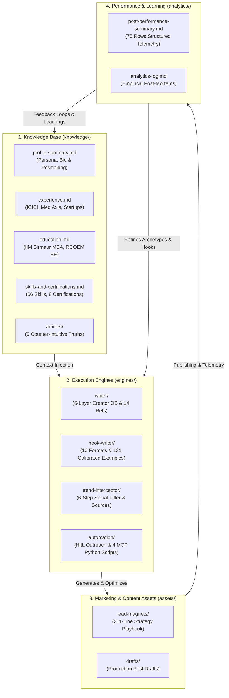

# Consolidated LinkedIn Growth System (Enterprise Creator OS)

[](#system-architecture)
[](#security--git-hygiene-protocol)
[](#autonomous-execution-engines)

An enterprise-grade, LLM-ready creator, content generation, and networking automation operating system built for **Ashutosh Bhandekar** (Enterprise Operator & AI Builder).

This repository consolidates personal brand IP, career telemetry, research archives, four autonomous execution engines, marketing assets, and empirical LinkedIn post analytics into a single clean architecture optimized for AI agent context injection and human executive execution.

---

## 1. System Architecture



---

## 2. Directory Layout

```
linkedin-growth-system/
├── .gitignore                          # Airtight exclusion (zero .exe, .zip, .docx, raw CSVs)
├── README.md                           # Master system specification & agent operating manual
│
├── knowledge/                          # Ground-truth persona & career intelligence
│   ├── profile-summary.md              # Bio, positioning, headline, and profile audit
│   ├── experience.md                   # Work history & quantified accomplishments (0 PII)
│   ├── education.md                    # MBA (IIM Sirmaur) & BE (RCOEM) credentials
│   ├── skills-and-certifications.md    # 66 skills categorized & 8 verified credentials
│   └── articles/                       # Published long-form thought leadership
│       └── 5-counter-intuitive-truths-linkedin-success-2025.md
│
├── engines/                            # Autonomous execution frameworks & agent skills
│   ├── writer/                         # Core LinkedIn writing system
│   │   ├── SKILL.md                    # 6-Layer / 5-Phase drafting pipeline orchestrator
│   │   ├── insight-vault.md            # Raw personal experiences, failures, and stories
│   │   ├── signature-assets.md         # Proprietary frameworks (Execution Stack, 60% Rule)
│   │   ├── references/                 # 14 Modular configuration and calibration guides
│   │   │   ├── authority-audit.md      # 6 binary quality gates & weighted scoring
│   │   │   ├── content-pillars.md      # 5 strategic pillars (AI Products, Enterprise, etc.)
│   │   │   ├── content-scoring.md      # 100-point rubric with forced justification
│   │   │   ├── copywriting-config.md   # Benefit framing, persuasion mechanics
│   │   │   ├── distribution-audit.md   # 5 viral mechanics dimensions
│   │   │   ├── hooks-framework.md      # 3-step formula (Lean-in, Scroll-stop, Snapback)
│   │   │   ├── humanizer-config.md     # 33 AI patterns, adaptive severity tiers
│   │   │   ├── icp-engine.md           # 6 reader personas & Think/Feel/Do framework
│   │   │   ├── lead-magnet-mode.md     # Rule of 3, Value/Tease architecture
│   │   │   ├── learning-layer.md       # Post-mortem & pattern mining engine
│   │   │   ├── narrative-engine.md     # 5 story archetypes (Transformation, Observation...)
│   │   │   ├── positioning-engine.md   # 5 lenses (Contrarian, Pattern Break, Hidden Cost...)
│   │   │   ├── sample-posts.md         # 5 tone calibration reference posts
│   │   │   └── style-guide.md          # Voice, rhythm, whitespace, zero em-dashes
│   │   └── scripts/                    # Helper Python scripts for outreach & automation
│   │
│   ├── hook-writer/                    # Dedicated scroll-stop & viral opener engine
│   │   ├── SKILL.md                    # Universal rules, character limits & 4 core formats
│   │   └── references/
│   │       └── EXAMPLES.md             # 131 annotated real-world hooks from 21 creators
│   │
│   ├── trend-interceptor/              # Real-time industry trend & signal listener
│   │   ├── SKILL.md                    # 6-step cognitive filter & B2B reframe pipeline
│   │   └── sources.md                  # Curated feeds (HackerNews, Reddit, TechCrunch, Lenny's)
│   │
│   └── automation/                     # Outbound networking & MCP automation engine
│       ├── SKILL.md                    # HitL protocols, volume safety limits, message templates
│       └── scripts/                    # Python MCP execution scripts
│           ├── draft_outbound.py       # Scrapes profiles and stages approval queue
│           ├── send_outbound.py        # Dispatches approved connection requests
│           ├── draft_followup.py       # Scans accepted leads for 3+ day follow-up
│           └── send_followup.py        # Transmits conversational follow-ups
│
├── assets/                             # Marketing collateral & production deliverables
│   ├── lead-magnets/
│   │   └── leadmagnet.md               # 311-line B2B lead magnet strategy & gating playbook
│   └── drafts/                         # Production-ready staged & published post drafts
│       ├── linkedin-post-2026-06-22-040800.txt
│       ├── linkedin-post-2026-06-22-041500.txt
│       ├── linkedin-post-2026-06-22-041700.txt
│       └── linkedin-post-2026-06-23-160700.txt
│
└── analytics/                          # Empirical performance tracking & post-mortems
    ├── analytics-log.md                # Qualitative iteration log & post-mortems
    └── post-performance-summary.md    # 75 rows from single post analytics in Markdown
```

---

## 3. Autonomous Execution Engines

### A. The Writer Engine (`engines/writer/`)
- **Pipeline:** 6 functional layers presented as 5 phases (Strategy, Idea Development, Creation, Quality, Distribution).
- **Quality Gates:** Every draft must pass the **Authority Audit v2** (Insight, Originality, Experience, Evidence, Memorability, Save tests) and score **85+/100** before voice calibration.
- **Style Invariants:** Ultra-short paragraphs (1–3 sentences), generous whitespace, bold on framework titles, strategic emojis (2–3 max at bullet starts), and an absolute ban on em-dashes (`—`).

### B. The Hook Writer (`engines/hook-writer/`)
- **Universal Constraints:** Max total length of **210 characters**, max single line length of **75 characters**, mobile 3-line fold optimization.
- **4 Formats:**
  1. *Dense:* 140–160 chars, zero line breaks, continuous high-density text.
  2. *Punchy + Context:* Line 1 (≤50 chars), blank line, Line 2 (≤50 chars).
  3. *Single-Line Bomb:* ≤50 chars total, one high-voltage sentence.
  4. *Stacked Quotes / List Hook:* 2–3 lines (≤60 chars each) with parallel structure or timeline compression.
- **Calibration Library:** 131 real-world annotated hooks across 21 top creators in `references/EXAMPLES.md`.

### C. The Trend Interceptor (`engines/trend-interceptor/`)
- **6-Step Pipeline:** Source Scan → Signal Extraction → Content Pillar Alignment → Positioning & Narrative Enrichment → ICP & Virality Scoring → Markdown Brainstorm Output.
- **Interconnection:** Seamlessly points to `engines/writer/` modules to enrich raw internet news into commercial B2B insights.

### D. The Automation Engine (`engines/automation/`)
- **Human-in-the-Loop (HitL):** Hardcoded safety limits (max 20 invites/day, max 30 DMs/day).
- **Execution Workflow:** `draft_outbound.py` generates an explicit Markdown approval queue (`outbound_queue.md`). Only items checked `[x]` by the human operator are dispatched by `send_outbound.py`.

---

## 4. Ground-Truth Knowledge Base

All career files are structured for LLM context injection without hallucinations or personal PII exposure:
- **`knowledge/experience.md`:** 6 career positions (Senior Manager BI at ICICI Prudential, Stealth Dental AI Founder, Med Axis 24 Healthcare BD, AaoStays Co-Founder, SarvM.AI Consultant, Marcamor Consulting). Documents key enterprise milestones (reducing fraud detection from 7 days to 15 minutes, cutting financial MIS reporting by 60%, 99%+ cumulative efficiency gains).
- **`knowledge/education.md`:** MBA from IIM Sirmaur (Student Council Infrastructure Secretary, crisis leadership managing 215 students during COVID-19 without an outbreak) and BE from RCOEM (E-Cell President).
- **`knowledge/skills-and-certifications.md`:** Complete catalog of 8 verified professional credentials and 66 endorsed skills categorized across 9 functional domains.
- **`knowledge/profile-summary.md`:** Executive narrative, recruiter bio, ATS keyword matrix, headline formulas, and About section copy.
- **`knowledge/articles/5-counter-intuitive-truths-linkedin-success-2025.md`:** Full markdown conversion of the published thought-leadership article analyzing platform virality, carousel dwell time, and the Top 1% commenter strategy.

---

## 5. Analytics & Empirical Performance

- **Quantitative Telemetry (`analytics/post-performance-summary.md`):** Comprehensive mapping of all 75 rows from the viral CareerFlow launch post:
  - **Impressions:** 24,403 (18,331 unique members reached)
  - **Saves:** 75 vs **Reactions:** 59 (**1.27x Save-to-Reaction ratio**, proving extreme utility)
  - **Conversion:** 151 profile views yielded 75 followers (**49.67% profile-to-follower conversion rate**)
  - **Demographics:** Senior talent (29%), Software Engineers (7%), IT Consulting (25%), US metro reach (4% NYC & SF).
- **Qualitative Learning Layer (`analytics/analytics-log.md`):** Detailed post-mortems of published posts, diagnosing algorithmic penalties, hook failures, and actionable style guide updates.

---

## 6. LLM Agent Prompting Guidelines

When interacting with this repository, AI agents (Claude, Gemini, Antigravity) must adhere to these directives:

1. **Persona Grounding:** Inject `knowledge/profile-summary.md` and `knowledge/experience.md` into system context. Ashutosh is an *Enterprise Operator turned AI Builder* who speaks from real production scars, not theoretical AI hype.
2. **Anti-Slop Enforcement:** Strictly follow `engines/writer/references/humanizer-config.md`. Never use forbidden AI words (*delve, tapestry, landscape, pivotal, foster, crucial*). Never use em-dashes.
3. **Tone Calibration:** Study `engines/writer/references/sample-posts.md`. Post length must remain between 1,800 and 2,800 characters (hard limit: 3,000 characters).
4. **Hook Verification:** Always validate candidate hooks against `engines/hook-writer/SKILL.md` length rules before presenting them.

---

## 7. Security & Git Hygiene Protocol

To maintain complete privacy and zero repository bloat:
- **Strictly Ignored via `.gitignore`:**
  - All executables and installers: `*.exe`, `*.dll`, `*.winmd`, `*.msi`
  - All archives: `*.zip`, `*.7z`, `*.tar.gz`, `*.skill`, `/Complete_LinkedInDataExport*`
  - Temporary and lock files: `~$*`, `*.tmp`
  - Proprietary documents & personal PDFs: `*.docx`, `*.pdf`, `heatig agets.png`
  - Raw PII data tables: `*.csv`, `*.tsv`, `*.xlsx`, `messages.csv`, `PhoneNumbers.csv`
  - Secrets and credentials: `.env*`, `*.pem`, `*.key`
- **Verification Command:**
  ```powershell
  git ls-files | Select-String -Pattern "\.(exe|dll|zip|docx|tmp|csv|xlsx|pdf|skill)$"
  ```
  Must always return **0 files**.
